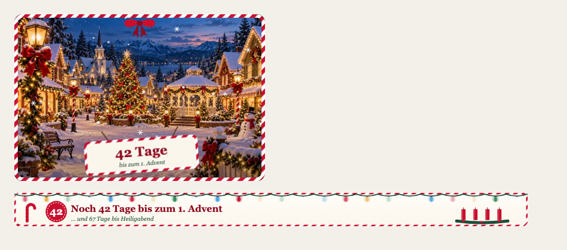

# Candy Cane 🍬

**Eine Saison-Mod für Claude Code: Halloween, Advent, Weihnachten und Silvester. Deutsch und Englisch.**
*A seasonal mod for Claude Code: Halloween, Advent, Christmas and New Year's Eve. German and English.*



## Was sie macht

Candy Cane richtet sich nach dem Kalender (Berliner Zeit):

| Zeitraum | Was passiert |
|---|---|
| Oktober | Herbst und Countdown bis Halloween. Am 31. heißt es „Süßes oder Saures!“ |
| ab 1. November | Countdown bis zum 1. Advent, und wie viele Tage es noch bis Heiligabend sind |
| ab dem 1. Advent | Schnee, Lichterkette, Adventskerzen, jeden Tag ein Türchen im Adventskalender und weihnachtliche Wartetexte, solange Claude arbeitet |
| Weihnachten bis Silvester | Festtagsgrüße, an Silvester ein Countdown bis Mitternacht |
| ab 2. Januar | Die Mod schläft bis zum nächsten Herbst |

Dazu kommen zwei Farbthemen (`weihnachten-hell`, `weihnachten-dunkel`). Mit dem Befehl `/weihnachten` stellst du die Stufe und die Sprache (Deutsch oder Englisch) um.

## Installation

1. Repo klonen, zum Beispiel nach `~/.claude/mods/candy-cane`:
   ```bash
   git clone https://github.com/philipkleudgen/candy-cane-mod ~/.claude/mods/candy-cane
   ```
2. In `~/.claude/settings.json` den Ordner eintragen:
   ```json
   {
     "env": {
       "CLAUDE_CODE_PLUGIN_DIRS": "~/.claude/mods/candy-cane"
     }
   }
   ```
   Wenn du schon andere Mods nutzt, hängst du den Pfad mit `:` an.
3. Claude Code neu starten.

---

## English

Candy Cane follows the calendar (Berlin time): an autumn countdown to **Halloween** in October, a countdown to the first Sunday of Advent from November 1st, then snow, a string of lights, Advent candles, a daily door in the Advent calendar and festive spinner texts while Claude is working. On New Year's Eve it counts down to midnight, and from January 2nd it sleeps until next autumn.

All texts come in **German and English**. Use `/weihnachten` to switch the language and the intensity.

**Install:** clone the repo to `~/.claude/mods/candy-cane`, add that path to `CLAUDE_CODE_PLUGIN_DIRS` under `env` in `~/.claude/settings.json` (separate several mods with `:`), then restart Claude Code.

---

## Eigene Mod oder Claude-Beratung?

Du willst eine eigene Mod für dein Team, Claude Code sauber in eure Abläufe bringen oder einfach wissen, was damit bei euch geht? Melde dich: **[philipkleudgen.de](https://philipkleudgen.de)**

*Want a custom mod for your team or help getting real work done with Claude? Get in touch at [philipkleudgen.de](https://philipkleudgen.de).*

---

Ein Hobbyprojekt, kostenlos und aus Spaß. Kein offizielles Produkt von Anthropic. Claude ist eine Marke von Anthropic.
*A free hobby project. Not affiliated with or endorsed by Anthropic.*

Lizenz: [MIT](LICENSE) · © 2026 Philip Kleudgen
